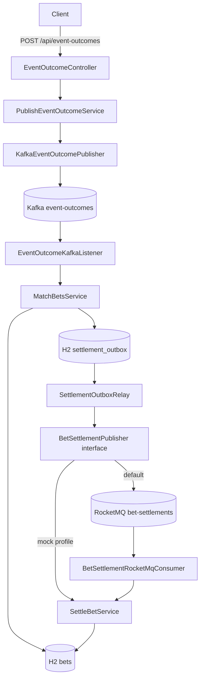

# Sports Betting Settlement Service

A Spring Boot service that simulates event outcome handling and bet settlement:

For a short interview walkthrough, see [DEMO.md](DEMO.md).

1. `POST /api/event-outcomes` publishes the outcome of one market of an event to the Kafka topic `event-outcomes`.
2. A Kafka consumer reads the outcome and finds the **pending** bets on that event and market in an in-memory H2
   database.
3. In the same database transaction, one settlement request per bet is written to the `settlement_outbox` table.
   A scheduled relay sends each request to the RocketMQ topic `bet-settlements`, then deletes the row.
4. A RocketMQ consumer settles each bet: **WON** if the bet's `eventWinnerId` equals the outcome's winner, otherwise
   **LOST**.



## Tech stack

| Concern     | Choice                                                                                                    |
|-------------|-----------------------------------------------------------------------------------------------------------|
| Runtime     | Java 25, Spring Boot 4.1.2, Maven wrapper                                                                 |
| Kafka       | `spring-boot-starter-kafka` (spring-kafka 4.1, Jackson 3 JSON serde), broker `apache/kafka:4.2.2` (KRaft) |
| RocketMQ    | `rocketmq-client-java` 5.2.2 (gRPC client, through the proxy), broker `apache/rocketmq:5.5.0`             |
| Storage     | H2 in-memory with Spring Data JPA                                                                         |
| API docs    | springdoc-openapi 3.2 (Swagger UI)                                                                        |
| Boilerplate | Lombok (loggers, constructor injection, JPA entity accessors)                                             |
| Tests       | JUnit 5, Mockito, MockMvc, Testcontainers 2 (Kafka and RocketMQ), Awaitility                              |

The RocketMQ Spring Boot starter is not used: its latest release (2.3.6) targets Spring Boot 2.7 and Jackson 2. The
plain gRPC client
has no dependency conflicts with Boot 4. `RocketMqConfig` wires its producer and push consumer as beans.

## Prerequisites

- JDK 25 (`java -version`)
- Docker with Compose v2 (for Kafka and RocketMQ, and for the end-to-end tests)
- For an IDE: Lombok support (bundled in IntelliJ IDEA; in VS Code / Cursor through the Java extension)

Ports used on localhost: `8080` (app), `9092` (Kafka), `9876` (RocketMQ name server), `8081` (RocketMQ proxy).

## Run

### 1. Start the brokers

```bash
docker compose up -d --wait
```

This starts Kafka and the RocketMQ name server, broker and proxy. A one-shot `rocketmq-init` container creates the
`bet-settlements` topic before the proxy starts. The command returns when the proxy accepts connections on port 8081,
after about 30 seconds.

### 2. Start the application

With real RocketMQ (default profile):

```bash
./mvnw spring-boot:run
```

With RocketMQ mocked (`mock` profile): the producer logs the payload and hands it to the settlement logic in-process.
Only Kafka is needed:

```bash
docker compose up -d kafka
./mvnw spring-boot:run -Dspring-boot.run.profiles=mock
```

On startup, five pending bets are seeded (disable with `-Dspring-boot.run.arguments=--app.seed.enabled=false`):

| Bet | User   | Event    | Picked winner |
|-----|--------|----------|---------------|
| 1   | user-1 | EVT-1001 | TEAM-RMA      |
| 2   | user-2 | EVT-1001 | TEAM-FCB      |
| 3   | user-3 | EVT-1001 | TEAM-RMA      |
| 4   | user-1 | EVT-2002 | TEAM-LAL      |
| 5   | user-4 | EVT-2002 | TEAM-BOS      |

### 3. Try it

Open [`http/bet-settlement.http`](http/bet-settlement.http) in IntelliJ IDEA (HTTP Client) or in VS Code / Cursor (REST
Client extension) and run the requests from top to bottom. Each request has a comment with the expected result:
the happy path for the seeded bets, a bet you place yourself, and the error cases.

The main steps with curl:

```bash
# Pending bets of event EVT-1001
curl -s 'localhost:8080/api/bets?eventId=EVT-1001'

# Publish the outcome: Real Madrid wins
curl -i -X POST localhost:8080/api/event-outcomes \
  -H 'Content-Type: application/json' \
  -d '{"eventId":"EVT-1001","eventMarketId":"MKT-MATCH-WINNER","eventName":"Real Madrid vs Barcelona","eventWinnerId":"TEAM-RMA"}'
# -> 202 Accepted

# A moment later: bets 1 and 3 are WON, bet 2 is LOST, each with settledAt
curl -s 'localhost:8080/api/bets?eventId=EVT-1001'

# Bets of EVT-2002 are untouched
curl -s 'localhost:8080/api/bets?status=PENDING'

# Place your own bet, then publish an outcome for its event
curl -i -X POST localhost:8080/api/bets \
  -H 'Content-Type: application/json' \
  -d '{"userId":"user-9","eventId":"EVT-3003","eventMarketId":"MKT-MATCH-WINNER","eventWinnerId":"TEAM-Z","amount":12.50}'
```

The application log shows each step: `Received outcome`, `Sent settlement request ... (messageId=...)` (or
`[mock RocketMQ] bet-settlements <- {...}`), and `Settled bet N ... as WON/LOST`.

### Tools

- Swagger UI: <http://localhost:8080/swagger-ui.html>
- H2 console: <http://localhost:8080/h2-console> (JDBC URL `jdbc:h2:mem:bets`, user `sa`, empty password)

### Stop

```bash
docker compose down
```

## API

| Method | Path                  | Description                                                                                                                        |
|--------|-----------------------|------------------------------------------------------------------------------------------------------------------------------------|
| POST   | `/api/event-outcomes` | Publish `{eventId, eventMarketId, eventName, eventWinnerId}` to Kafka. `202` on broker ack, `400` on invalid body, `503` if Kafka is unreachable. |
| GET    | `/api/bets`           | List bets, optional filters `eventId` and `status` (`PENDING`, `WON`, `LOST`).                                                     |
| GET    | `/api/bets/{id}`      | One bet, `404` if unknown.                                                                                                         |
| POST   | `/api/bets`           | Place a bet `{userId, eventId, eventMarketId, eventWinnerId, amount}`. `201` with `Location`, `400` on invalid body.               |

Errors use RFC 9457 problem details; validation errors list the failing fields under `errors`.

## Tests

```bash
./mvnw -B -ntp verify
```

This is the same command that CI runs (`.github/workflows/ci.yml`). The brokers from `docker-compose.yml` are not
needed: the end-to-end tests start their own containers.

- Unit tests: the settlement rule in `Bet`, matching and settling services, and the RocketMQ consumer's
  acknowledge-or-retry decisions.
- Web slice test: validation and error mapping of `POST /api/event-outcomes`.
- End-to-end tests: they post an outcome and wait until the bets are settled, with real Kafka in Testcontainers.
  `RocketMqBetSettlementFlowTest` runs the default profile against a real RocketMQ broker: the name server, the broker
  and the gRPC proxy run in one `apache/rocketmq:5.5.0` container, and the test creates the topic itself.
  `BetSettlementFlowTest` runs the `mock` profile. Both are skipped automatically when Docker is not available.

## Design

Layered layout under `com.sporty.settlement`:

```
web/                 REST controllers, problem-detail error handler
web/dto/             Request and response bodies of the REST API
messaging/           Shared messaging exception
messaging/kafka/     event-outcomes publisher and listener
messaging/rocketmq/  bet-settlements publisher (real), in-process publisher (mock profile), push consumer
messaging/dto/       Wire contracts of both topics
service/             Publish outcome, match bets, outbox relay, settle bet, query and create bets;
                     BetSettlementPublisher
service/dto/         Service input (CreateBetCommand)
persistence/         BetRepository, SettlementOutboxRepository, OutboxEntry; the JPA entities, Spring Data
                     repositories and mapper stay package-private
domain/              Bet (settlement rule), BetStatus, EventOutcome, BetSettlementCommand. No framework code.
config/              Clock, topic, RocketMQ and outbox properties, Kafka topic and error handler, RocketMQ clients,
                     scheduling, seed data
```

The REST controllers and both message listeners are entry points that call the services. The services use
`persistence` and the message publishers. The JPA entity is kept separate from the domain `Bet`, so the settlement rule
has no
framework code. `BetSettlementPublisher` is the only interface: it has a real RocketMQ implementation and an in-process
one, so switching to the mock is a profile choice.

### Messages

- `event-outcomes` (Kafka): JSON `{"eventId","eventMarketId","eventName","eventWinnerId"}`, keyed by `eventId`, so all
  outcomes of one event stay ordered on one partition. The outcome settles only the bets on its `eventMarketId`. The app creates the topic (3 partitions) on startup.
- `bet-settlements` (RocketMQ): one message per bet, JSON `{"betId","eventId","outcomeWinnerId"}`, message key =
  `betId`,
  tag `SETTLE`. The message carries the outcome winner, not the result: the consumer settles the bet through
  `Bet.settle`, so the WON/LOST rule lives in one place, the domain.

### Reliability

Both brokers deliver at least once, so every step is idempotent:

- Matching only picks bets that are still `PENDING`. If a repeated outcome arrives before the first settlements finish,
  matching can write duplicate requests to the outbox; settlement idempotency (next bullet) makes those duplicates
  safe. Once every bet is settled, a further outcome writes nothing.
- Settlement skips a bet that is already settled. Concurrent duplicates are caught by JPA optimistic locking
  (`@Version`);
  the losing message is retried and then skipped.
- Kafka listener: transient failures are retried 3 times, 1 second apart, then logged and skipped. Malformed JSON and
  invalid payloads are not retried.
- RocketMQ listener: transient failures return `FAILURE`, so the broker redelivers and eventually moves the message to
  the consumer group's DLQ. Messages that can never succeed (malformed, unknown bet) are logged and acknowledged.
- Transactional outbox: matching reads the pending bets and inserts the outbox rows in one transaction, so a crash
  cannot lose a request. The relay (`SettlementOutboxRelay`, every `app.outbox.poll-interval`, up to
  `app.outbox.batch-size` rows) has no transaction open while it talks to the broker. It deletes a row only after the
  send succeeds. If a send fails, the relay stops the run and retries the same row on the next poll, so the order
  stays FIFO. A crash between send and delete sends the request again, which settlement idempotency makes safe.

## Assumptions and trade-offs

- **No payout.** A bet has no odds, so settlement records only `WON`/`LOST` and `settledAt`.
- **The outcome names one market.** The spec's outcome has no market. This service requires `eventMarketId` on the
  outcome, so the result of one market (for example match winner) cannot settle bets on another market of the same
  event. The settlement message does not carry the market: matching already selects the bets of that market.
- **Polling outbox relay.** The relay polls the table; it does not use change data capture. Delivery is at least
  once, not exactly once. With more than one app instance, two relays can send the same row; settlement idempotency
  makes that safe, and a row lock (`SELECT ... FOR UPDATE SKIP LOCKED`) would remove the duplicate work.
- **No Kafka dead-letter topic.** Records that still fail after retries are logged and skipped. A
  `DeadLetterPublishingRecoverer` would be a one-line addition.
- **H2 is in-memory.** Data, including seeded bets, resets on every restart.
- **Single-node brokers.** Replication factor 1 and no security, for local use only.
- **Shutdown.** The RocketMQ push consumer's `close()` waits for its in-flight long-poll (about 30 seconds). It is
  capped at 5 seconds,
  and unacknowledged messages are redelivered.
