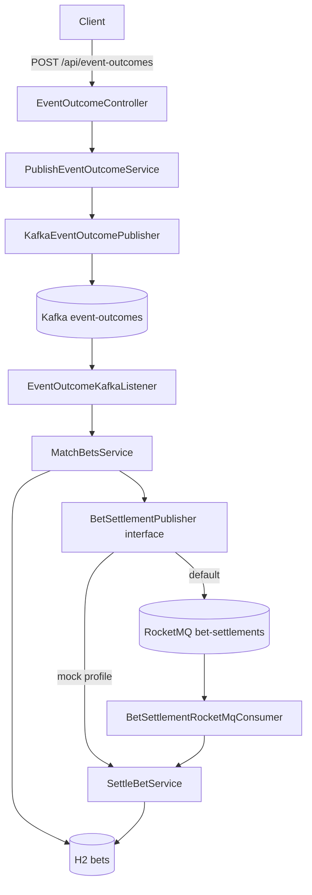

# Sports Betting Settlement Service

A Spring Boot service that simulates event outcome handling and bet settlement:

1. `POST /api/event-outcomes` publishes an event outcome to the Kafka topic `event-outcomes`.
2. A Kafka consumer reads the outcome and finds the **pending** bets of that event in an in-memory H2 database.
3. One settlement request per bet is sent to the RocketMQ topic `bet-settlements`.
4. A RocketMQ consumer settles each bet: **WON** if the bet's `eventWinnerId` equals the outcome's winner, otherwise **LOST**.



## Tech stack

| Concern  | Choice |
|----------|--------|
| Runtime  | Java 25, Spring Boot 4.1.2, Maven wrapper |
| Kafka    | `spring-boot-starter-kafka` (spring-kafka 4.1, Jackson 3 JSON serde), broker `apache/kafka:4.2.2` (KRaft) |
| RocketMQ | `rocketmq-client-java` 5.2.2 (gRPC client, through the proxy), broker `apache/rocketmq:5.5.0` |
| Storage  | H2 in-memory with Spring Data JPA |
| API docs | springdoc-openapi 3.2 (Swagger UI) |
| Boilerplate | Lombok (loggers, constructor injection, JPA entity accessors) |
| Tests    | JUnit 5, Mockito, MockMvc, Testcontainers 2 (Kafka and RocketMQ), Awaitility |

The RocketMQ Spring Boot starter is not used: its latest release (2.3.6) targets Spring Boot 2.7 and Jackson 2. The plain gRPC client
has no dependency conflicts with Boot 4. `RocketMqConfig` wires its producer and push consumer as beans.

## Prerequisites

- JDK 25 (`java -version`)
- Docker with Compose v2 (for Kafka and RocketMQ, and for the end-to-end tests)
- For an IDE: Lombok support (bundled in IntelliJ IDEA; in VS Code / Cursor through the Java extension)

Ports used on localhost: `8080` (app), `9092` (Kafka), `9876` (RocketMQ name server), `8081` (RocketMQ proxy).

## Run

### 1. Start the brokers

```bash
docker compose up -d
```

This starts Kafka, the RocketMQ name server, broker and proxy, and a one-shot `rocketmq-init` container that creates the
`bet-settlements` topic. RocketMQ needs about 20 to 30 seconds. Wait until the init container has exited and the proxy
is listening on port 8081 (the init script does not wait for the proxy):

```bash
docker compose ps -a        # rocketmq-init should show "Exited (0)"
docker logs rocketmq-init   # prints "create topic to ... success."
docker logs rmqproxy        # prints "rocketmq-proxy startup successfully"
```

### 2. Start the application

With real RocketMQ (default profile):

```bash
./mvnw spring-boot:run
```

With RocketMQ mocked (`mock` profile): the producer logs the payload and hands it to the settlement logic in-process. Only Kafka is needed:

```bash
docker compose up -d kafka
./mvnw spring-boot:run -Dspring-boot.run.profiles=mock
```

On startup, five pending bets are seeded (disable with `-Dspring-boot.run.arguments=--app.seed.enabled=false`):

| Bet | User   | Event    | Picked winner |
|-----|--------|----------|---------------|
| 1   | user-1 | EVT-1001 | TEAM-RMA      |
| 2   | user-2 | EVT-1001 | TEAM-FCB      |
| 3   | user-3 | EVT-1001 | TEAM-RMA      |
| 4   | user-1 | EVT-2002 | TEAM-LAL      |
| 5   | user-4 | EVT-2002 | TEAM-BOS      |

### 3. Try it

Open [`http/bet-settlement.http`](http/bet-settlement.http) in IntelliJ IDEA (HTTP Client) or in VS Code / Cursor
(REST Client extension) and run the requests from top to bottom. Each request has a comment with the expected result:
the happy path for the seeded bets, a bet you place yourself, and the error cases.

The main steps with curl:

```bash
# Pending bets of event EVT-1001
curl -s 'localhost:8080/api/bets?eventId=EVT-1001'

# Publish the outcome: Real Madrid wins
curl -i -X POST localhost:8080/api/event-outcomes \
  -H 'Content-Type: application/json' \
  -d '{"eventId":"EVT-1001","eventName":"Real Madrid vs Barcelona","eventWinnerId":"TEAM-RMA"}'
# -> 202 Accepted

# A moment later: bets 1 and 3 are WON, bet 2 is LOST, each with settledAt
curl -s 'localhost:8080/api/bets?eventId=EVT-1001'

# Bets of EVT-2002 are untouched
curl -s 'localhost:8080/api/bets?status=PENDING'

# Place your own bet, then publish an outcome for its event
curl -i -X POST localhost:8080/api/bets \
  -H 'Content-Type: application/json' \
  -d '{"userId":"user-9","eventId":"EVT-3003","eventMarketId":"MKT-MATCH-WINNER","eventWinnerId":"TEAM-Z","amount":12.50}'
```

The application log shows each step: `Received outcome`, `Sent settlement request ... (messageId=...)` (or
`[mock RocketMQ] bet-settlements <- {...}`), and `Settled bet N ... as WON/LOST`.

### Tools

- Swagger UI: <http://localhost:8080/swagger-ui.html>
- H2 console: <http://localhost:8080/h2-console> (JDBC URL `jdbc:h2:mem:bets`, user `sa`, empty password)

### Stop

```bash
docker compose down
```

## API

| Method | Path                    | Description |
|--------|-------------------------|-------------|
| POST   | `/api/event-outcomes`   | Publish `{eventId, eventName, eventWinnerId}` to Kafka. `202` on broker ack, `400` on invalid body, `503` if Kafka is unreachable. |
| GET    | `/api/bets`             | List bets, optional filters `eventId` and `status` (`PENDING`, `WON`, `LOST`). |
| GET    | `/api/bets/{id}`        | One bet, `404` if unknown. |
| POST   | `/api/bets`             | Place a bet `{userId, eventId, eventMarketId, eventWinnerId, amount}`. `201` with `Location`, `400` on invalid body. |

Errors use RFC 9457 problem details; validation errors list the failing fields under `errors`.

## Tests

```bash
./mvnw -B -ntp verify
```

This is the same command that CI runs (`.github/workflows/ci.yml`). The brokers from `docker-compose.yml` are not
needed: the end-to-end tests start their own containers.

- Unit tests: the settlement rule in `Bet`, matching and settling services, and the RocketMQ consumer's acknowledge-or-retry decisions.
- Web slice test: validation and error mapping of `POST /api/event-outcomes`.
- End-to-end tests: they post an outcome and wait until the bets are settled, with real Kafka in Testcontainers.
  `RocketMqBetSettlementFlowTest` runs the default profile against a real RocketMQ broker: the name server, the broker
  and the gRPC proxy run in one `apache/rocketmq:5.5.0` container, and the test creates the topic itself.
  `BetSettlementFlowTest` runs the `mock` profile. Both are skipped automatically when Docker is not available.

## Design

Layered layout under `com.sporty.settlement`:

```
web/                 REST controllers, problem-detail error handler
web/dto/             Request and response bodies of the REST API
messaging/           Shared messaging exception
messaging/kafka/     event-outcomes publisher and listener
messaging/rocketmq/  bet-settlements publisher (real), in-process publisher (mock profile), push consumer
messaging/dto/       Wire contracts of both topics
service/             Publish outcome, match bets, settle bet, query and create bets; BetSettlementPublisher
service/dto/         Service input (CreateBetCommand)
persistence/         BetRepository; the JPA entity, Spring Data repository and mapper stay package-private
domain/              Bet (settlement rule), BetStatus, EventOutcome, BetSettlementCommand. No framework code.
config/              Clock, topic and RocketMQ properties, Kafka topic and error handler, RocketMQ clients, seed data
```

The REST controllers and both message listeners are entry points that call the services. The services use
`persistence` and the message publishers. The JPA entity is kept separate from the domain `Bet`, so the settlement rule has no
framework code. `BetSettlementPublisher` is the only interface: it has a real RocketMQ implementation and an in-process
one, so switching to the mock is a profile choice.

### Messages

- `event-outcomes` (Kafka): JSON `{"eventId","eventName","eventWinnerId"}`, keyed by `eventId`, so all outcomes of one event
  stay ordered on one partition. The app creates the topic (3 partitions) on startup.
- `bet-settlements` (RocketMQ): one message per bet, JSON `{"betId","eventId","outcomeWinnerId"}`, message key = `betId`,
  tag `SETTLE`. The message carries the outcome winner, not the result: the consumer settles the bet through
  `Bet.settle`, so the WON/LOST rule lives in one place, the domain.

### Reliability

Both brokers deliver at least once, so every step is idempotent:

- Matching only picks bets that are still `PENDING`. If a repeated outcome arrives before the first settlements finish,
  matching can publish duplicate requests; settlement idempotency (next bullet) makes those duplicates safe. Once every
  bet is settled, a further outcome publishes nothing.
- Settlement skips a bet that is already settled. Concurrent duplicates are caught by JPA optimistic locking (`@Version`);
  the losing message is retried and then skipped.
- Kafka listener: transient failures are retried 3 times, 1 second apart, then logged and skipped. Malformed JSON and
  invalid payloads are not retried.
- RocketMQ listener: transient failures return `FAILURE`, so the broker redelivers and eventually moves the message to
  the consumer group's DLQ. Messages that can never succeed (malformed, unknown bet) are logged and acknowledged.
- The matching step holds no database transaction while it talks to the broker.

## Assumptions and trade-offs

- **No payout.** A bet has no odds, so settlement records only `WON`/`LOST` and `settledAt`.
- **`eventMarketId` is stored but not used for matching.** The outcome message carries no market, so bets are matched by `eventId` alone.
- **No transactional outbox.** If the app crashes after reading bets but before every RocketMQ message is sent, the
  Kafka offset is not committed and the outcome is reprocessed. The idempotency rules above make that safe, but there
  is no atomic "DB + broker" guarantee. An outbox table would close that gap.
- **No Kafka dead-letter topic.** Records that still fail after retries are logged and skipped. A
  `DeadLetterPublishingRecoverer` would be a one-line addition.
- **H2 is in-memory.** Data, including seeded bets, resets on every restart.
- **Single-node brokers.** Replication factor 1 and no security, for local use only.
- **Shutdown.** The RocketMQ push consumer's `close()` waits for its in-flight long-poll (about 30 seconds). It is capped at 5 seconds,
  and unacknowledged messages are redelivered.
